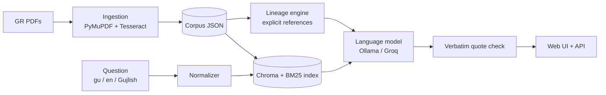

# GovResolve-AI

[](https://github.com/Vivek-Maheshwari-07/GovResolve-AI/actions/workflows/ci.yml)
[](LICENSE)
[](requirements/base.txt)

A Gujarati-English assistant for Government Resolutions (GRs), built for the Seva First Innovation Challenge, problem statement PS000230.
It answers questions in Gujarati, English or transliterated Gujarati ("Gujlish"), quotes the source word for word, and shows whether a later order has amended or superseded the rule.

## Why this exists

- **Rules change quietly.** A resolution from 2018 may have been amended in 2021 or replaced in 2024. A plain keyword search returns all of them with equal weight, so an officer can apply a rule that no longer holds.
- **Users switch languages.** Questions arrive in Gujarati script, in English, or in Latin-script Gujarati. Keyword search fails across those boundaries.
- **Many source documents are scans.** Old resolutions often have no usable text layer, so they need OCR before they can be searched.

## Features

- **Grounded answers.** Every answer carries the document, page, issue date and a verbatim quote taken from the stored page text. A model never retypes a quote.
- **Amendment lineage.** A graph links each GR to the older GRs it amends or supersedes. Links come only from explicit references and always point from the newer order to the older one.
- **Honest status.** A GR is shown as `superseded`, `amended`, `no_later_amendment_found` or `unknown`. The system never says "active": finding no later order does not prove a rule is in force.
- **Refusals instead of guesses.** When the documents do not support an answer, the response says so and gives a reason code (for example `NO_DOCUMENT`, `OUT_OF_SCOPE`, `BROKEN_CHAIN`).
- **Hybrid search.** Dense vectors (bge-m3 through Ollama) and BM25 with a Gujarati stemmer are combined by reciprocal rank fusion.
- **OCR for scans.** PyMuPDF reads text layers; Tesseract (`guj+eng`) handles scanned pages and records bounding boxes so the cited passage can be boxed on the PDF page.
- **Pluggable language model.** Local Ollama by default, Groq or any OpenAI-compatible service as an option. With no model reachable, the app returns one verbatim passage with a warning.
- **Web interface.** A React app with the answer, citations, the original PDF with the cited passage highlighted, and a lineage view.

## How it works



## Repository layout

| Path | Contents |
|---|---|
| `backend/app/` | FastAPI application, lineage engine, SQLite store, API schemas |
| `backend/rag/` | Search index, question normalizer, answer pipeline, language-model providers |
| `backend/ingestion/` | PDF to GR record conversion (text layer and OCR) |
| `backend/scripts/` | Corpus, index, dataset curation, scorecard and smoke-test tools |
| `backend/tests/` | Backend test suite (pytest); `manual/` holds slow smoke scripts |
| `backend/config/` | Glossaries for Gujarati and Gujlish normalization |
| `frontend/` | React 18 and Vite web app |
| `data/` | Processed GR records, search index, demo fixtures, Tesseract language data, and `eval/` (gold questions, lineage gold set, saved scorecards) |
| `docs/` | API contract, design documents, provider guide, implementation plan, notes |
| `deploy/` | Dockerfile and Docker Compose file |
| `requirements/` | Python dependencies: `base.txt`, `dev.txt`, `optional.txt` |
| `.github/` | CI workflow, issue and PR templates, CONTRIBUTING and SECURITY |

## Quick start

Requirements: Python 3.10+, Node.js 18+ (20 recommended), and [Tesseract](https://github.com/tesseract-ocr/tesseract) if you ingest new PDFs.
For local answers install [Ollama](https://ollama.com) and pull the models: `ollama pull qwen3.5:4b` and `ollama pull bge-m3`.

```bash
git clone https://github.com/Vivek-Maheshwari-07/GovResolve-AI.git
cd GovResolve-AI
python -m venv .venv
source .venv/bin/activate          # Windows: .venv\Scripts\activate
make install                       # Python and web dependencies
cp .env.example .env               # edit to choose Ollama or Groq
python run.py                      # Windows: double-click start.bat
```

`run.py` builds the web UI on first run, then serves the app and API at <http://localhost:8000> (API docs at `/docs`).
It uses the bundled records in `data/processed` and the index in `data/index/chroma`. If either is missing it starts with synthetic demo documents and says so.

On a CPU, expect 40 to 70 seconds per answer with the local model. Groq answers in about 10 seconds but sends the question and evidence passages to a hosted service.

Other ways to run:

```bash
make demo           # synthetic documents only, no model needed
make docker-up      # Docker (files in deploy/); set GOV_ADMIN_TOKEN in .env first
make help           # list every shortcut
```

## Configuration

All settings live in `.env` (see `.env.example`, which documents each one). The most useful:

| Variable | Purpose |
|---|---|
| `LLM_PROVIDER` | `ollama` (default), `groq`, `openai`, `gemini` or `auto` |
| `GROQ_API_KEY` | Needed only for Groq |
| `GOV_ENGINE` | `squad2` answers through the RAG pipeline; `retrieval` returns passages only |
| `GOV_ADMIN_TOKEN` | Protects `/admin/*`, `/logs`, `/api/upload` and writes to `/documents`; without it they work from this machine only. Set it whenever the server is reachable by anyone else |
| `GOV_CORS_ORIGINS` | Allowed browser origins, as a JSON list |
| `GOV_QUERY_RATE_PER_MIN` | Questions per client per minute (default 120) |

Never commit `.env`. Details of the language-model options are in [docs/LLM_PROVIDERS.md](docs/LLM_PROVIDERS.md).

## API overview

The full contract, including field meanings, is in [docs/API_CONTRACT.md](docs/API_CONTRACT.md). Public field names are frozen.

| Method and path | Purpose |
|---|---|
| `POST /query` | Ask a question; returns `verdict`, `answer`, `citations`, `statements`, `warnings` |
| `GET /documents`, `GET /documents/{id}` | List documents and read one with its lineage status |
| `GET /lineage/{id}` | Lineage graph around a document |
| `GET /grs`, `GET /grs/{id}/pdf` | Library listing and the source PDF |
| `POST /ask` | Question with clause-level status and a query id for feedback |
| `GET /health` | Corpus, edge and index counts |

Example:

```bash
curl -X POST http://localhost:8000/query \
  -H "Content-Type: application/json" \
  -d '{"question": "What is the upper age limit for direct selection of a Stenographer, Grade III?", "language": "en"}'
```

A successful response has `"verdict": "answered"`. Each citation has `doc_id`, `page`, `quote`, `issue_date`, `bbox` and a `lineage` object. A refusal has `"verdict": "insufficient_evidence"` with `reason` and `reason_code`.

## Development

```bash
make test       # backend (pytest) and frontend tests
make lint       # ruff
make ui         # build the web app into frontend/dist
make llm-check  # verify Ollama or Groq setup
```

Frontend development server: `cd frontend && npm run dev` (port 3000, proxies API calls to port 8000).
Read [CONTRIBUTING.md](.github/CONTRIBUTING.md) before changing lineage, citation or API behaviour, and [docs/IMPLEMENTATION_PLAN.md](docs/IMPLEMENTATION_PLAN.md) for the code map.

## Evaluation

Saved scorecards, the gold questions and honest notes on what works and what does not are in [data/eval/SCORECARD_SUMMARY.md](data/eval/SCORECARD_SUMMARY.md).
Known limits: Gujarati lineage detection is weak, and the gold questions have not been validated by officers.

## Documentation

See [docs/README.md](docs/README.md) for the design documents and [SECURITY.md](.github/SECURITY.md) for reporting vulnerabilities. Release notes are in [CHANGELOG.md](CHANGELOG.md).

## License

MIT. See [LICENSE](LICENSE).
