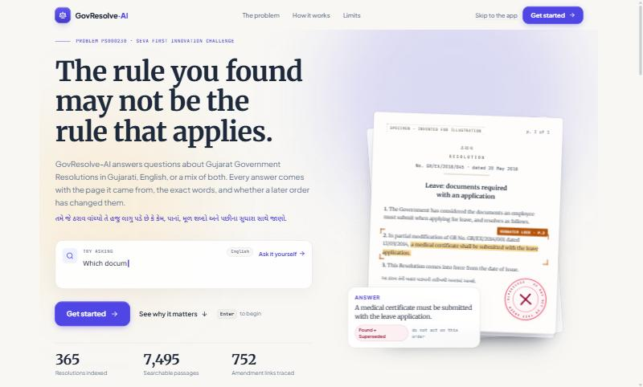
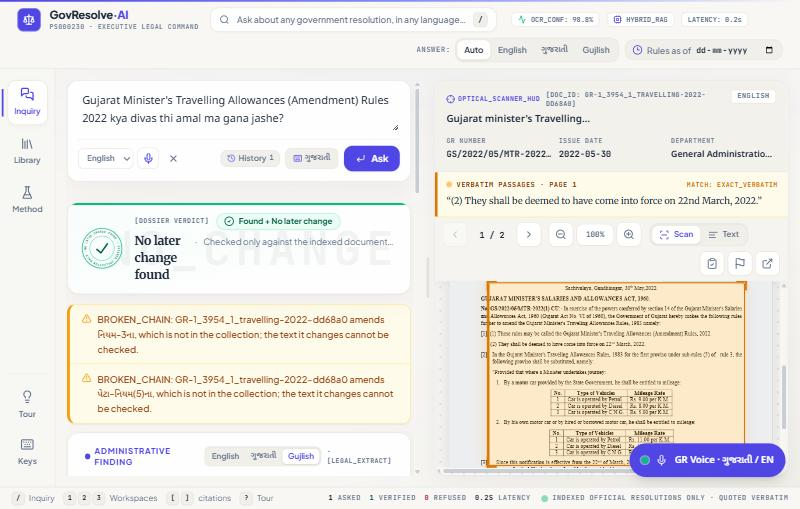
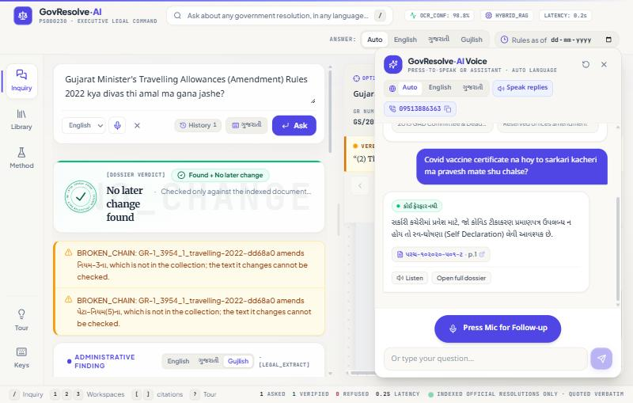
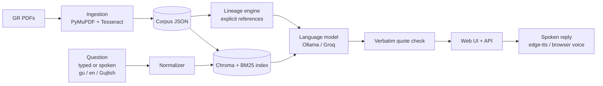

# GovResolve-AI

[](https://github.com/Vivek-Maheshwari-07/GovResolve-AI/actions/workflows/ci.yml)
[](LICENSE)
[](requirements/base.txt)

A Gujarati-English assistant for Government Resolutions (GRs), built for the Seva First Innovation Challenge, problem statement PS000230.
It answers questions in Gujarati, English or transliterated Gujarati ("Gujlish"), quotes the source word for word, and shows whether a later order has amended or superseded the rule. A voice assistant can listen to the question and read the answer aloud.



## Why this exists

- **Rules change quietly.** A resolution from 2018 may have been amended in 2021 or replaced in 2024. A plain keyword search returns all of them with equal weight, so an officer can apply a rule that no longer holds.
- **Users switch languages.** Questions arrive in Gujarati script, in English, or in Latin-script Gujarati. Keyword search fails across those boundaries.
- **Many source documents are scans.** Old resolutions often have no usable text layer, and some digital ones use legacy fonts whose text layer is garbled, so they need OCR before they can be searched.

## Features

- **Grounded answers.** Every answer carries the document, page, issue date and a verbatim quote taken from the stored page text. A model never retypes a quote.
- **Amendment lineage.** A graph links each GR to the older GRs it amends or supersedes. Links come only from explicit references and always point from the newer order to the older one.
- **Honest status.** A GR is shown as `superseded`, `amended`, `no_later_amendment_found` or `unknown`. The system never says "active": finding no later order does not prove a rule is in force.
- **Refusals instead of guesses.** When the documents do not support an answer, the response says so and gives a reason code (for example `NO_DOCUMENT`, `OUT_OF_SCOPE`, `BROKEN_CHAIN`).
- **Hybrid search.** Dense vectors (bge-m3 through Ollama) and BM25 with a Gujarati stemmer are combined by reciprocal rank fusion.
- **OCR that reads each page in the right language.** PyMuPDF reads text layers. Scanned pages, and pages whose text layer is garbled, go to Tesseract at 300 DPI after straightening; a mostly Gujarati page is read with the Gujarati model alone (mixing in English turns Gujarati words into Latin junk). Bounding boxes are kept so the cited passage can be boxed on the PDF page.
- **Voice assistant.** The chat panel listens, answers and speaks:
  - the language you speak or type is detected automatically (Gujarati, English or Gujlish);
  - a **reply-language selector** (Auto / English / ગુજરાતી) forces the answer language, so you can ask in English and hear Gujarati; Auto answers in the language of the question;
  - recording ends when you have finished, not at the first pause: it learns the room's noise and waits for a silence that fits what you said (see [`endpointing.js`](frontend/src/lib/endpointing.js));
  - answers are read aloud with natural Gujarati and English voices (optional `edge-tts`, falling back to the browser's voices) and every reply has a Listen button.
- **Simple-words explanation.** A cited resolution can be explained in plain language, written from the resolution's stored text only.
- **Pluggable language model.** Local Ollama by default, Groq or any OpenAI-compatible service as an option. With no model reachable, the app returns one verbatim passage with a warning.
- **Web interface.** A React app with the answer, citations, the original PDF with the cited passage highlighted, a lineage view, a library of every resolution, a guided tour and an animated landing page. The interface language (English, Gujarati, Gujlish) is saved in the browser. Official source quotations always stay verbatim.
- **Admin page.** `/admin` lets a password holder add a PDF to the collection (see below).
- **Local CPU speed option.** Set `LOCAL_FAST_MODE=1` in `.env` to skip an extra Gujarati translation for English and Gujlish questions. Local CPU response time is hardware- and question-dependent.

| Answer with the cited page highlighted | Voice assistant: a Gujlish question answered in Gujarati |
|---|---|
|  |  |

## How it works



## Repository layout

| Path | Contents |
|---|---|
| `backend/app/` | FastAPI application, lineage engine, SQLite store, API schemas, voice and text-to-speech routes |
| `backend/rag/` | Search index, question normalizer, answer pipeline, language-model providers |
| `backend/ingestion/` | PDF to GR record conversion; `ocr.py` is the shared Tesseract reader |
| `backend/scripts/` | Corpus, index, OCR repair, evaluation and smoke-test tools (see [Tools](#tools)) |
| `backend/tests/` | Backend test suite (pytest); `manual/` holds slow smoke scripts |
| `backend/config/` | Glossaries for Gujarati and Gujlish normalization |
| `frontend/` | React 18 and Vite web app |
| `data/` | `processed/` and `index/chroma/` (the tracked 156-document demo set), `fixtures/` (synthetic documents), `tessdata/` (Tesseract language data), `eval/` (gold questions, lineage gold set, saved scorecards) |
| `docs/` | API contract, design documents, provider guide, implementation plan, notes, screenshots |
| `deploy/` | Dockerfile and Docker Compose file |
| `requirements/` | Python dependencies: `base.txt`, `dev.txt`, `optional.txt` |
| `.github/` | CI workflow, issue and PR templates, CONTRIBUTING and SECURITY |

## Quick start

Requirements: Python 3.10+, Node.js 18+ (20 recommended), and [Tesseract](https://github.com/tesseract-ocr/tesseract) if you ingest new PDFs.
For local answers install [Ollama](https://ollama.com) and pull the models: `ollama pull qwen3.5:4b` and `ollama pull bge-m3`.

```bash
git clone https://github.com/Vivek-Maheshwari-07/GovResolve-AI.git
cd GovResolve-AI
python -m venv .venv
source .venv/bin/activate          # Windows: .venv\Scripts\activate
make install                       # Python and web dependencies
cp .env.example .env               # edit to choose Ollama or Groq
python run.py                      # Windows: double-click start.bat
```

`run.py` loads `.env`, builds the web UI on first run, then serves the app and API at <http://localhost:8000> (API docs at `/docs`).
It uses `GOV_CORPUS_DIR` and `GOV_SQUAD2_INDEX_DIR` when set; otherwise it prefers `data/corpus_v2` and then `data/processed`, with `data/index/chroma` as the index. If no corpus is found it starts with synthetic demo documents and says so.
With nothing but the clone you get the 156-document demo set; the full 366-document collection is built from `final_dataset/` (below).

Optional extras: `pip install -r requirements/optional.txt` adds `edge-tts` (spoken replies in Gujarati and English), Gemini and local sentence-transformers.

On a CPU, expect 40 to 70 seconds per answer with the local model. With Groq (`LLM_PROVIDER=groq`) an answer takes about 2 seconds
(measured 26 Nov 2026, see [docs/DEMO.md](docs/DEMO.md)), but the question and evidence passages are sent to a hosted service.
A question asked before is answered from the answer cache at once.

Other ways to run:

```bash
make demo           # synthetic documents only, no model needed
make docker-up      # Docker (files in deploy/); set GOV_ADMIN_TOKEN in .env first
make help           # list every shortcut
```

### Voice setup

| Part | Needs | Without it |
|---|---|---|
| Speaking a question | `GROQ_API_KEY` (or `OPENAI_API_KEY`) for Whisper, which detects Gujarati or English from the audio | The browser's speech recognition is used; it listens in the interface language and works in Chrome and Edge |
| Hearing the answer | `pip install edge-tts` (internet; only the answer text is sent to Microsoft's speech service). `TTS_PROVIDER=off` disables it | The browser's own voice is used; most Windows installs have no Gujarati voice, so Gujarati answers may stay silent |

### Admin page: adding a GR
Open `http://localhost:8000/admin`, sign in with the password in `GOV_ADMIN_TOKEN` (set it in `.env`, then restart), and upload a PDF. The page is not linked from the
public portal, and the server refuses every upload that does not carry the password (5 wrong tries in a minute lock the address out for that minute). With no
`GOV_ADMIN_TOKEN` the page stays locked. An uploaded GR appears in the library at once; the answer engine finds it after the server restarts and the index is
updated (`make index`). Add public, official documents only: everything uploaded is visible to all portal users.

### Build the full collection from `final_dataset/`

The supplied dataset is `final_dataset.rar` (not in git). Extract it into `final_dataset/` in the repository root (`tar -xf final_dataset.rar` on Windows). From `backend/`:

```powershell
$env:TESSDATA_PREFIX = (Resolve-Path ..\data\tessdata).Path
python -m scripts.ocr_to_gr_json --families ..\final_dataset\rule_families.csv --pdf-root ..\final_dataset --out ..\data\.cache\gr_json_families --workers 6
python -m scripts.build_corpus --manifest ..\final_dataset\manifest.csv --root ..\final_dataset --sources ..\final_dataset\SOURCES_full_per_file_urls.txt --families-json ..\data\.cache\gr_json_families --out ..\data\corpus_v2 --workers 6
python -m scripts.repair_garbled_pages --corpus ..\data\corpus_v2 --pdf-root ..\final_dataset --apply    # re-reads legacy-font pages with OCR
ollama pull bge-m3
python -m scripts.build_squad2_index --corpus ..\data\corpus_v2 --index ..\data\index\chroma_bge
```

Then set `GOV_CORPUS_DIR=./data/corpus_v2`, `GOV_SQUAD2_INDEX_DIR=./data/index/chroma_bge`, `CHROMA_PERSIST_DIR=./data/index/chroma_bge` and `EMBEDDING_MODEL=ollama:bge-m3` in `.env`.
The generated corpus and index are local data and are not committed. After changing a corpus, delete `data/index/answers.json`: the answer cache does not notice edited text.

## Configuration

All settings live in `.env` (see `.env.example`, which documents each one). The most useful:

| Variable | Purpose |
|---|---|
| `LLM_PROVIDER` | `ollama` (default), `groq`, `nvidia`, `openai`, `gemini` or `auto` |
| `GROQ_API_KEY` | Needed for Groq answers and for Whisper speech-to-text |
| `NVIDIA_API_KEY` | Needed only for NVIDIA NIM (`build.nvidia.com`) |
| `GOV_ENGINE` | `squad2` answers through the RAG pipeline; `retrieval` returns passages only |
| `GOV_CORPUS_DIR`, `GOV_SQUAD2_INDEX_DIR` | Corpus folder and search index to use |
| `TTS_PROVIDER`, `TTS_VOICE_GU`, `TTS_VOICE_EN` | Spoken replies: `off` disables, the voices can be changed |
| `GOV_ADMIN_TOKEN` | Protects `/admin/*`, `/logs`, `/voice/calls`, `/api/upload` and writes to `/documents`; without it they work from this machine only. Set it whenever the server is reachable by anyone else |
| `GOV_VOICE_TOKEN` | Optional secret for `/voice/query` and `/voice/webhook` (via `X-Voice-Token` or `Authorization: Bearer`) |
| `GOV_CORS_ORIGINS` | Allowed browser origins, as a JSON list |
| `GOV_QUERY_RATE_PER_MIN` | Questions per client per minute (default 120) |
| `TESSERACT_CMD` | Path to `tesseract` if it is not on `PATH` |

Never commit `.env`. Details of the language-model options are in [docs/LLM_PROVIDERS.md](docs/LLM_PROVIDERS.md).

## API overview

The full contract, including field meanings, is in [docs/API_CONTRACT.md](docs/API_CONTRACT.md). Public field names are frozen.

| Method and path | Purpose |
|---|---|
| `POST /query` | Ask a question; returns `verdict`, `answer`, `citations`, `statements`, `warnings` |
| `POST /query/stream` | Same answer as newline-delimited JSON: one line per pipeline step (with its time), then the `/query` response |
| `GET /documents`, `GET /documents/{id}` | List documents and read one with its lineage status |
| `GET /lineage/{id}` | Lineage graph around a document |
| `GET /grs`, `GET /grs/{id}/pdf` | Library listing and the source PDF |
| `POST /ask` | Question with clause-level status and a query id for feedback |
| `POST /explain` | Simple-words explanation of a cited resolution |
| `POST /translate` | Gujarati / English translation of an answer or warning |
| `POST /voice/transcribe` | Speech to text (Whisper); the language is detected from the audio |
| `POST /voice/speak`, `GET /voice/speak` | Text to speech (MP3), and whether it is available |
| `GET /health` | Corpus, edge and index counts |

Example:

```bash
curl -X POST http://localhost:8000/query \
  -H "Content-Type: application/json" \
  -d '{"question": "What is the upper age limit for direct selection of a Stenographer, Grade III?", "language": "en"}'
```

A successful response has `"verdict": "answered"`. Each citation has `doc_id`, `page`, `quote`, `issue_date`, `bbox` and a `lineage` object. A refusal has `"verdict": "insufficient_evidence"` with `reason` and `reason_code`.

## Tools

Run from `backend/` as `python -m scripts.<name>`:

| Script | Purpose |
|---|---|
| `build_corpus`, `ocr_to_gr_json`, `pdf_to_gr_json` | Build corpus records from the PDFs (text layer or OCR) |
| `repair_garbled_pages` | Re-read legacy-font pages whose text layer is garbled; backs up first, `--apply` writes |
| `enrich_metadata`, `enrich_subjects` | Fill in and correct dates, GR numbers and subjects |
| `build_squad2_index` | Build or refresh the Chroma and BM25 search index (re-embeds only changed chunks) |
| `build_lineage`, `eval_lineage` | Build the amendment graph and score it against the gold edges |
| `scorecard`, `naive_eval`, `make_gold_questions`, `make_heldout_questions`, `verify_demo_queries` | Evaluation and demo checks |
| `llm_smoke`, `preflight` | Check the language-model setup and the demo machine |
| `curate_150_dataset`, `ingest_accurate`, `gold_lineage_review` | How the 156-document demo set was curated and reviewed |

## Development

```bash
make test       # backend (pytest) and frontend tests
make lint       # ruff
make ui         # build the web app into frontend/dist
make llm-check  # verify Ollama or Groq setup
```

Frontend development server: `cd frontend && npm run dev` (port 3000, proxies API calls to port 8000).
Read [CONTRIBUTING.md](.github/CONTRIBUTING.md) before changing lineage, citation or API behaviour, and [docs/IMPLEMENTATION_PLAN.md](docs/IMPLEMENTATION_PLAN.md) for the code map.

## Evaluation

Saved scorecards, the gold questions and honest notes on what works and what does not are in [data/eval/SCORECARD_SUMMARY.md](data/eval/SCORECARD_SUMMARY.md).
Known limits: Gujarati lineage detection is weak, Gujarati OCR uses the fast Tesseract model (about 52% word confidence on poor scans; the "best" model would help), and the gold questions have not been validated by officers.

## Documentation

See [docs/README.md](docs/README.md) for the design documents and [SECURITY.md](.github/SECURITY.md) for reporting vulnerabilities. Release notes are in [CHANGELOG.md](CHANGELOG.md).

## License

MIT. See [LICENSE](LICENSE).
