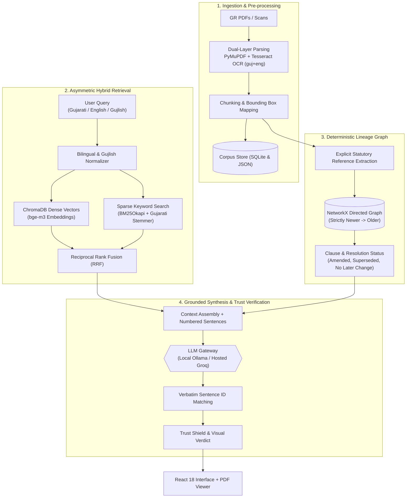

# GovResolve-AI (PS000230)

[](https://github.com/Vivek-Maheshwari-07/GovResolve-AI/actions/workflows/ci.yml)
[](LICENSE)
[](requirements.txt)
[](https://fastapi.tiangolo.com)
[](https://react.dev)

> **High-Accuracy Bilingual (Gujarati–English) AI Assistant for Government Resolutions**  
> Developed for the **Seva First Innovation Challenge (PS000230)**.

---

## Problem Solved

Navigating Government Resolutions (GRs), notifications, and administrative circulars presents acute challenges for departments, legal officers, and citizens:

1. **The "Amendment Trap":**  
   Government rules are amended, substituted, and superseded quietly over time. A 2018 resolution establishing a quota, fee, or service rule might be superseded or amended by a 2021 or 2024 resolution. Traditional search engines retrieve all matching keywords equally, leading officers to inadvertently apply repealed, superseded, or partially amended rules. GovResolve-AI eliminates this risk by building a deterministic, direction-enforced lineage graph that traces amendments and displays status alongside every cited rule.
2. **Gujlish Queries & Code-Switching:**  
   Users frequently query administrative portals in Gujarati script, English, or transliterated Gujarati in Latin script ("Gujlish", e.g., *"makan bhada bhattha mate su niyam chhe?"*). Standard search fails across these language boundaries. GovResolve-AI features an integrated phonological normalizer and administrative lexicon stemmer to normalize bilingual and Gujlish queries seamlessly.
3. **Corrupted & Scanned PDFs:**  
   Legacy and regional government documents frequently feature broken unicode fonts, lossy embedded text layers, or non-searchable scanned images. GovResolve-AI applies a dual-layer extraction pipeline (PyMuPDF text extraction + Google Tesseract OCR with `guj+eng` language models) that extracts clean text, computes bounding box coordinates (`bboxes`) for verbatim passage highlighting, and scores OCR confidence.

---

## Core Architecture

GovResolve-AI combines deterministic graph computation with modern retrieval-augmented generation to provide legally verifiable, hallucination-free answers:



### 1. Asymmetric Hybrid RAG
- **ChromaDB with `bge-m3`:** Captures deep cross-lingual semantics across Gujarati and English administrative vocabularies.
- **Sparse `BM25Okapi` with Gujarati Suffix-Stripping:** Guarantees exact statutory token matches (GR numbers, departments, section names).
- **Reciprocal Rank Fusion (RRF):** Fuses dense vector scores and sparse keyword ranks to produce high-precision evidence candidates without embedding drift.

### 2. Deterministic Lineage Graph Injection
- Implemented with **NetworkX**, enforcing strict temporal and directional integrity: edges point exclusively from **newer resolution $\rightarrow$ older resolution**.
- Extracts explicit statutory amendment phrases (e.g., *"in supersession of"*, *"further to amend"*, *"આથી રદ કરવામાં આવે છે"*).
- Pre-injects amending and superseding resolutions directly into the RAG context window, alerting the language model before generation begins.
- Strictly adheres to the rule: **never output an "active" status**—absence of an amendment indicates *No later change found in collection*, never conclusive legal validity.

### 3. Dual-Layer OCR & Optical Verification
- Leverages **PyMuPDF (`fitz`)** for rapid native digital extraction and word coordinate mapping.
- Automatically invokes **Google Tesseract OCR (`guj+eng`)** when embedded font streams are missing, corrupt, or score low character confidence.
- Records exact pixel bounding boxes for every chunk, enabling verbatim quote highlighting in the integrated PDF Inspector.

---

## Tech Stack

| Layer | Technologies |
|---|---|
| **Backend Framework** | **FastAPI** (Python 3.10+), Pydantic v2, Uvicorn, Python-Multipart |
| **Lineage & Graph Engine** | **NetworkX**, NetworkX MultiDiGraph |
| **Vector & Search Storage** | **ChromaDB** (`bge-m3`), **Rank-BM25** (`BM25Okapi`) |
| **Database & Metadata** | **SQLite** (Audit logging, feedback collection, overrides) |
| **Document Processing & OCR** | **PyMuPDF** (`fitz`), **Google Tesseract OCR** (`guj+eng`) |
| **LLM Inference Gateway** | **Ollama** (`qwen3.5:4b`, offline CPU/GPU) or **Groq** (`openai/gpt-oss-120b`) |
| **Frontend UI** | **React 18**, **Vite**, Tailwind CSS, Lucide Icons |

---

## Setup Instructions

### Prerequisites
- **Python 3.10 or higher**
- **Node.js 18+ (Node 20 LTS recommended)** & `npm`
- **Google Tesseract OCR** with `guj` and `eng` trained data packages installed.
- *(Optional)* [Ollama](https://ollama.com) for local offline LLM inference (`ollama pull qwen3.5:4b` and `ollama pull bge-m3`).

---

### Step 1: Clone and Configure Environment

```bash
git clone https://github.com/Vivek-Maheshwari-07/GovResolve-AI.git
cd GovResolve-AI
```

Create a `.env` file in the project root:

```env
# Language Model Configuration (choose ollama, groq, or openai)
LLM_PROVIDER=ollama
OLLAMA_HOST=http://localhost:11434
OLLAMA_MODEL=qwen3.5:4b

# Hosted Groq Fallback (Optional)
GROQ_API_KEY=your_groq_api_key_here
GROQ_MODEL=openai/gpt-oss-120b

# Search & Verification Configuration
EMBEDDING_MODEL=ollama:bge-m3
CHROMA_PERSIST_DIR=./data/index/chroma
ANSWER_CHECK=off
GOV_ENGINE=squad2

# CORS & Server Settings
GOV_CORS_ORIGINS=["*"]
cors_origins=["*"]

# OCR Configuration
TESSERACT_CMD=tesseract
```

---

### Step 2: Backend Setup & Execution

Install Python dependencies:

```bash
python -m pip install -r requirements.txt
```

Launch the FastAPI backend service via Uvicorn:

```bash
# From repository root:
cd backend
uvicorn app.main:app --host 0.0.0.0 --port 8000 --reload
```

*The backend will be available at `http://127.0.0.1:8000` with interactive Swagger docs at `http://127.0.0.1:8000/docs`.*

---

### Step 3: Frontend Setup & Execution

Open a separate terminal:

```bash
# Navigate to frontend directory
cd frontend

# Install dependencies
npm install

# Start Vite development server
npm run dev
```

*The frontend application will be accessible at `http://localhost:5173`.*

---

### Step 4: Running Test Suites

Run the backend test suite:

```bash
python -m pytest backend/tests -v
```

Run the frontend test suite:

```bash
cd frontend && npm test
```

---

## API Usage

### 1. Upload Resolution PDF (`POST /api/upload`)
Uploads a scanned or digital Government Resolution PDF for dynamic ingestion, dual-layer OCR text extraction, chunking, and live lineage indexing.

- **Endpoint:** `POST /api/upload`
- **Content-Type:** `multipart/form-data`
- **Payload:** `file=@resolution.pdf`

**Example Response:**
```json
{
  "status": "ok",
  "gr_id": "GAD-2024-e41b46",
  "gr_number": "CRR/102024/104/G.2",
  "pages": 4
}
```

---

### 2. Fast Query Pipeline (`POST /query` or `POST /api/query`)
High-speed query endpoint utilizing asymmetric hybrid retrieval, guardrails, and deterministic lineage status synthesis.

- **Endpoint:** `POST /query`
- **Content-Type:** `application/json`

**Example Request:**
```json
{
  "question": "What is the maximum casual leave period for Gujarat state government employees?",
  "language": "en"
}
```

**Example Response:**
```json
{
  "question": "What is the maximum casual leave period for Gujarat state government employees?",
  "answer_status": "FOUND",
  "summary": "State employees are eligible for a maximum of 12 days casual leave per calendar year under the revised rules.",
  "statements": [
    {
      "explanation": "State government employees are eligible for up to 12 days casual leave annually.",
      "label": "Established",
      "cited_sentence_ids": ["GAD-2024-e41b46_c1_s2"]
    }
  ],
  "citations": [
    {
      "sentence_id": "GAD-2024-e41b46_c1_s2",
      "gr_id": "GAD-2024-e41b46",
      "gr_number": "CRR/102024/104/G.2",
      "quote": "State government employees shall be entitled to 12 days of casual leave in each calendar year.",
      "page": 1,
      "issue_date": "2024-03-15",
      "department": "General Administration Department",
      "status": "NO_LATER_CHANGE"
    }
  ],
  "warnings": [],
  "collection_latest_date": "2026-03-31"
}
```

---

### 3. Comprehensive Grounded Ask (`POST /api/ask`)
Primary endpoint for the React UI, returning deep clause-level status (`AMENDED`, `SUPERSEDED`, `NO_LATER_CHANGE`), quote bounding boxes for PDF rendering, and audit trail IDs.

- **Endpoint:** `POST /api/ask`
- **Content-Type:** `application/json`

**Example Request:**
```json
{
  "question": "વર્ગ-૪ કર્મચારીઓના પ્રમોશન માટેના નિયમો શું છે?",
  "language": "gu"
}
```

**Example Response:**
```json
{
  "query_id": "q-9b0d1e2f",
  "question": "વર્ગ-૪ કર્મચારીઓના પ્રમોશન માટેના નિયમો શું છે?",
  "answer": "વર્ગ-૪ કર્મચારીઓને પ્રમોશન માટે ન્યૂનતમ ૫ વર્ષની સંતોષકારક સેવા આવશ્યક છે...",
  "verdict": "FOUND",
  "lineage_status": "AMENDED",
  "citations": [
    {
      "gr_id": "FD-2022-ab3fe6",
      "gr_number": "PVS/102022/45/P",
      "quote": "વર્ગ-૪ કર્મચારીઓને પ્રમોશન આપવા માટે પાંચ વર્ષની સેવા...",
      "page_number": 2,
      "bounding_box": [72.0, 144.5, 520.0, 180.2],
      "amended_by": "FD-2024-885ae5"
    }
  ],
  "trust_score": {
    "verbatim_quote_count": 1,
    "established_statements": 1,
    "inferred_statements": 0
  }
}
```

---

## License

This project is licensed under the [MIT License](LICENSE).
