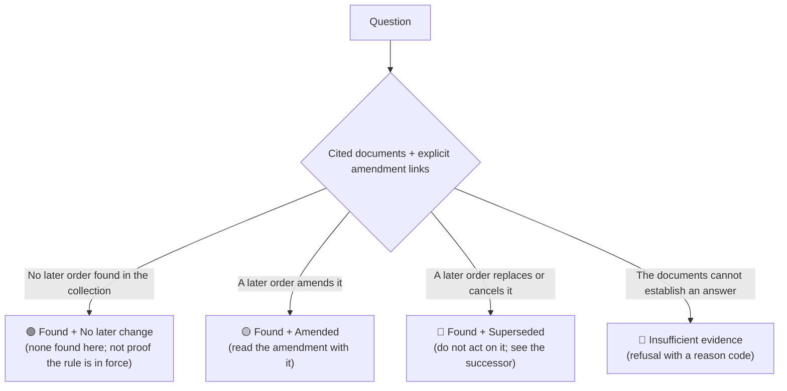
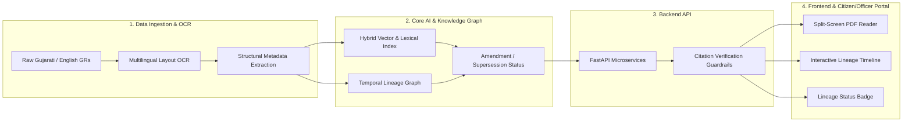

# GovResolve-AI (PS000230)

> **Next-Generation Bilingual (Gujarati–English) Retrieval-Augmented Generation (RAG) System for Government Resolutions (GRs) with Verifiable Citation Grounding and Temporal Amendment Lineage Tracking.**

[](#)
[](#)
[](#)
[](#)

---

## 📌 Executive Summary

Government Resolutions (GRs) and official administrative orders are published continuously across departments in state governance (such as the Government of Gujarat). Officials, citizens, legal practitioners, and administrators face a critical challenge: **identifying whether an existing resolution remains legally valid, has been amended, or has been completely superseded by a later order.**

**GovResolve-AI** resolves this challenge with an authoritative, bilingual RAG platform engineered specifically for administrative documents. It pairs high-fidelity Gujarati-English semantic retrieval with temporal document-graph reasoning to deliver accurate answers backed by line-level PDF citations and interactive lineage trees.

---

## 🚨 Core Problems Solved

| Problem | Challenge | GovResolve-AI Solution |
| :--- | :--- | :--- |
| **Administrative "Dirty Reads"** | Officials frequently enforce or act on outdated provisions of an old GR without realizing a subsequent amendment altered financial limits, eligibility criteria, or procedures. | **Temporal Citation Graph Engine** maps all subsequent amending GRs and alerts administrators with real-time dependency status. |
| **Superseded & Repealed Rules** | Standard keyword or semantic search often retrieves old, high-profile GRs that have been repealed by newer notifications, leading to unlawful administrative decisions. | **Supersession Classifier** tracks explicit repeal clauses and implicit overrides to mark obsolete documents clearly. |
| **Missing / Hallucinated Evidence** | Generic LLMs fabricate circular references or conflate GR numbers, dates, and departmental circulars with no verifiable paper trail. | **Strict Grounding & Split-Screen Evidence**: All generated points cite exact GR number, date, issuing department, and page-level PDF bounding box coordinates. |

---

## 🛡️ Status Taxonomy: what every answer says about the rule

Every answer carries the lineage status of the documents it cites. Statuses come **only from explicit references** in the documents
(an order that says it amends, replaces or cancels another), and the system **never calls a rule "active"**: finding no later order in
the collection does not prove a rule is still in force.



1. **`Found + No later change`**: no later amending or replacing order was found in the indexed documents.
2. **`Found + Amended`**: a later order amends a cited document; the lineage shows which one and quotes the sentence that says so.
3. **`Found + Superseded`**: a later order replaces or cancels a cited document; the successor is shown.
4. **`Insufficient evidence`**: the system refuses, with a reason code (`NO_DOCUMENT`, `TOO_VAGUE`, `OUT_OF_SCOPE`, `BROKEN_CHAIN`, ...), instead of guessing.

Each statement in an answer is also labelled `Established` (stated in a cited passage) or `Inferred`, and every quote is verbatim from its page.

---

## 🏛️ System Architecture



---

## 👥 Team Structure & Squad Distribution

To deliver a scalable, verifiable GovTech solution, the team is structured into 4 specialized squads:

### 1. Data Engineering & Ingestion Squad
- **Focus**: Ingestion pipeline, PDF preprocessing, Indic OCR, layout parsing, and gazette archival.
- **Key Deliverables**:
  - High-accuracy OCR pipeline for Gujarati and English circulars with tabular and stamp layout preservation.
  - Automated GR metadata extractor (GR Number, Department, Issuing Date, Signatory Authority, Subject/વિષય).
  - Storage architecture for raw PDFs and processed structured payloads.

### 2. Core AI & Knowledge Graph Squad
- **Focus**: Multilingual retrieval, Indic embeddings, Citation Graph, and RAG reasoning.
- **Key Deliverables**:
  - Hybrid retrieval engine (Dense embeddings + BM25 keyword matching optimized for Gujarati legal/administrative phrasing).
  - Temporal Citation & Lineage Graph linking referencing GRs, amendments, and supersessions.
  - Strict citation grounding prompt chains with zero-hallucination verification checks.

### 3. Backend & API Services Squad
- **Focus**: High-performance backend, vector DB integration, session management, and microservice orchestration.
- **Key Deliverables**:
  - FastAPI REST endpoints for search, verification, lineage queries, and PDF delivery.
  - Vector store (ChromaDB) and BM25 keyword index over every passage, with GR number and date look-up.
  - Audit logging, caching, and administrative RBAC (Role-Based Access Control).

### 4. Frontend & UX Squad
- **Focus**: User experience for administrative officers, legal researchers, and citizens.
- **Key Deliverables**:
  - Interactive split-screen interface displaying AI response alongside the original PDF with highlighted coordinates.
  - Visual **Lineage Timeline** tracking parent-child GR relationships over time.
  - Clear **lineage status** badges (no later change / amended / superseded / insufficient evidence).

---

## 🛠️ Technology Stack

- **Frontend**: React 18, Vite, Tailwind CSS, Framer Motion, Lucide icons, PDF.js (fonts and PDF worker bundled, works offline)
- **Backend**: Python 3.10+, FastAPI, Uvicorn, Pydantic
- **Retrieval**: ChromaDB vectors with `bge-m3` embeddings (via Ollama) + BM25 (`rank-bm25`), fused; cross-lingual English rendering of Gujarati / Gujlish questions
- **Answers**: local `qwen3.5:4b` through Ollama (default, offline); any OpenAI-compatible hosted model optional; a model-free fallback that quotes one verified passage
- **Lineage**: explicit-reference detector and graph (NetworkX), edges always newer → older
- **OCR & documents**: PyMuPDF, pdfplumber, Tesseract (`guj+eng`)

---

## 🚀 Repository Quickstart

### Prerequisites
- Python 3.10+, Node.js 18+ (to build the UI once), Git
- [Ollama](https://ollama.com) with `ollama pull qwen3.5:4b` and `ollama pull bge-m3`
- The GR corpus and search index (not in git; see `backend/README.md` to rebuild them from `final_dataset/`)

### Run it
```bash
git clone https://github.com/Vivek-Maheshwari-07/GovResolve-AI.git
cd GovResolve-AI
python -m venv .venv
.venv\Scripts\python -m pip install -r requirements.txt -r backend/requirements.txt
copy .env.example .env
python run.py            # or double-click start.bat; opens http://localhost:8000
```
`run.py` finds the corpus and index, builds the web UI the first time and starts everything on this machine only.
Without a corpus it starts on small synthetic fixtures and says so.

### Learn more
- `backend/README.md`: setup, rebuilding the data, configuration, evaluation commands
- `backend/DEMO.md`: five demo scenarios and their honest limits
- `eval/SCORECARD_SUMMARY.md`: measured results (development and held-out questions)
- `backend/API_CONTRACT.md`: the API

---

## 📄 License

Apache License 2.0.
