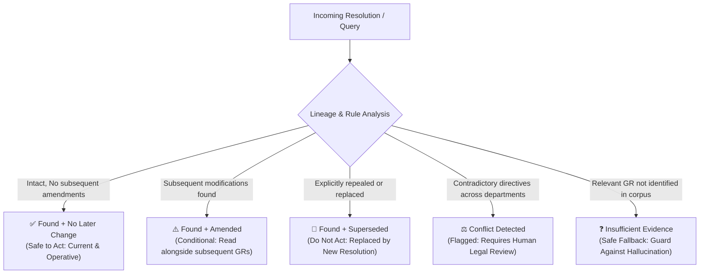
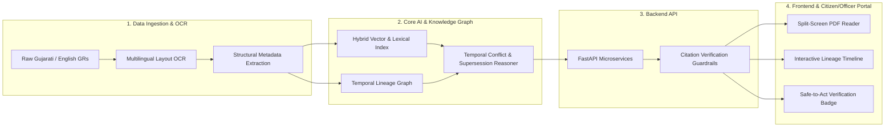

# GovResolve-AI (PS000230)

> **Next-Generation Bilingual (Gujarati–English) Retrieval-Augmented Generation (RAG) System for Government Resolutions (GRs) with Verifiable Citation Grounding and Temporal Amendment Lineage Tracking.**

[](#)
[](#)
[](#)
[](#)

---

## 📌 Executive Summary

Government Resolutions (GRs) and official administrative orders are published continuously across departments in state governance (such as the Government of Gujarat). Officials, citizens, legal practitioners, and administrators face a critical challenge: **identifying whether an existing resolution remains legally valid, has been amended, or has been completely superseded by a later order.**

**GovResolve-AI** resolves this challenge with an authoritative, bilingual RAG platform engineered specifically for administrative documents. It pairs high-fidelity Gujarati-English semantic retrieval with temporal document-graph reasoning to deliver accurate answers backed by line-level PDF citations and interactive lineage trees.

---

## 🚨 Core Problems Solved

| Problem | Challenge | GovResolve-AI Solution |
| :--- | :--- | :--- |
| **Administrative "Dirty Reads"** | Officials frequently enforce or act on outdated provisions of an old GR without realizing a subsequent amendment altered financial limits, eligibility criteria, or procedures. | **Temporal Citation Graph Engine** maps all subsequent amending GRs and alerts administrators with real-time dependency status. |
| **Superseded & Repealed Rules** | Standard keyword or semantic search often retrieves old, high-profile GRs that have been repealed by newer notifications, leading to unlawful administrative decisions. | **Supersession Classifier** tracks explicit repeal clauses and implicit overrides to mark obsolete documents clearly. |
| **Missing / Hallucinated Evidence** | Generic LLMs fabricate circular references or conflate GR numbers, dates, and departmental circulars with no verifiable paper trail. | **Strict Grounding & Split-Screen Evidence**: All generated points cite exact GR number, date, issuing department, and page-level PDF bounding box coordinates. |

---

## 🛡️ Status Taxonomy: "Safe-to-Act" Framework

Every retrieved resolution and query result is classified into a 5-state administrative status taxonomy:



1. **`Found + No later change` (Safe to Act)**: The resolution is retrieved, verified as active, and no subsequent modifications exist in the government gazette.
2. **`Found + Amended`**: The resolution is active in principle, but specific clauses or schedules have been modified by later resolutions. Highlights the exact diffs.
3. **`Found + Superseded`**: The resolution has been repealed, replaced, or rendered obsolete by a subsequent order. Automatically redirects to the operative replacement.
4. **`Conflict`**: Multiple operative circulars from overlapping jurisdictions or departments issue contradictory directions; flagged for administrative/legal review.
5. **`Insufficient Evidence`**: The system cannot locate authoritative gazetted GRs addressing the query; guards against hallucinating administrative authority.

---

## 🏛️ System Architecture



---

## 👥 Team Structure & Squad Distribution

To deliver a scalable, verifiable GovTech solution, the team is structured into 4 specialized squads:

### 1. Data Engineering & Ingestion Squad
- **Focus**: Ingestion pipeline, PDF preprocessing, Indic OCR, layout parsing, and gazette archival.
- **Key Deliverables**:
  - High-accuracy OCR pipeline for Gujarati and English circulars with tabular and stamp layout preservation.
  - Automated GR metadata extractor (GR Number, Department, Issuing Date, Signatory Authority, Subject/વિષય).
  - Storage architecture for raw PDFs and processed structured payloads.

### 2. Core AI & Knowledge Graph Squad
- **Focus**: Multilingual retrieval, Indic embeddings, Citation Graph, and RAG reasoning.
- **Key Deliverables**:
  - Hybrid retrieval engine (Dense embeddings + BM25 keyword matching optimized for Gujarati legal/administrative phrasing).
  - Temporal Citation & Lineage Graph linking referencing GRs, amendments, and supersessions.
  - Strict citation grounding prompt chains with zero-hallucination verification checks.

### 3. Backend & API Services Squad
- **Focus**: High-performance backend, vector DB integration, session management, and microservice orchestration.
- **Key Deliverables**:
  - FastAPI REST endpoints for search, verification, lineage queries, and PDF delivery.
  - Vector database management (Qdrant / Milvus) with metadata filtering by department, date, and validity.
  - Audit logging, caching, and administrative RBAC (Role-Based Access Control).

### 4. Frontend & UX Squad
- **Focus**: User experience for administrative officers, legal researchers, and citizens.
- **Key Deliverables**:
  - Interactive split-screen interface displaying AI response alongside the original PDF with highlighted coordinates.
  - Visual **Lineage Timeline** tracking parent-child GR relationships over time.
  - Distinct **Safe-to-Act** indicator badges giving instant clarity on resolution validity.

---

## 🛠️ Technology Stack

- **Frontend**: React, Vite, Tailwind CSS, Lucide Icons, PDF.js
- **Backend**: Python 3.10+, FastAPI, Uvicorn, Pydantic
- **Vector & Graph Storage**: Qdrant / ChromaDB, NetworkX / Neo4j
- **AI & NLP**: LangChain / LlamaIndex, Sentence-Transformers (IndicBERT / Multilingual-e5), Gemini / OpenAI API
- **OCR & Document Processing**: Surya OCR / Tesseract / Marker, PyMuPDF, pdfplumber

---

## 🚀 Repository Quickstart

### Prerequisites
- Python 3.10 or higher
- Node.js (v18+) & npm
- Git

### Initial Setup
```bash
# Clone the repository
git clone https://github.com/Vivek-Maheshwari-07/GovResolve-AI.git
cd GovResolve-AI
```

---

## 📄 License

This project is licensed under the Apache License 2.0 - see the LICENSE file for details.
