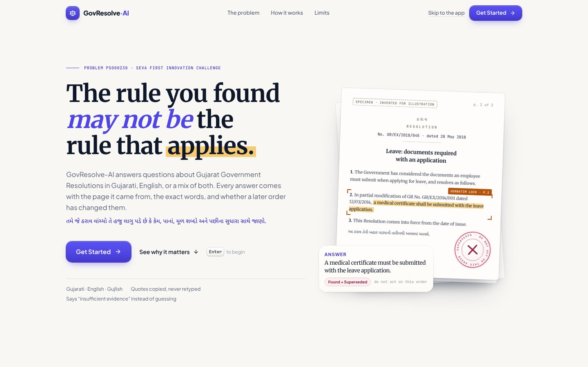
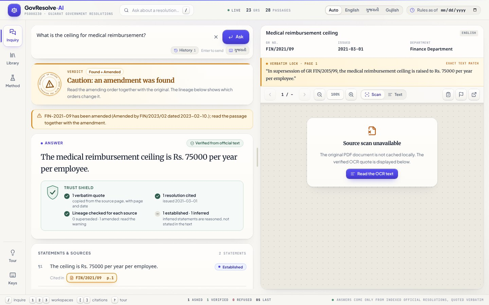
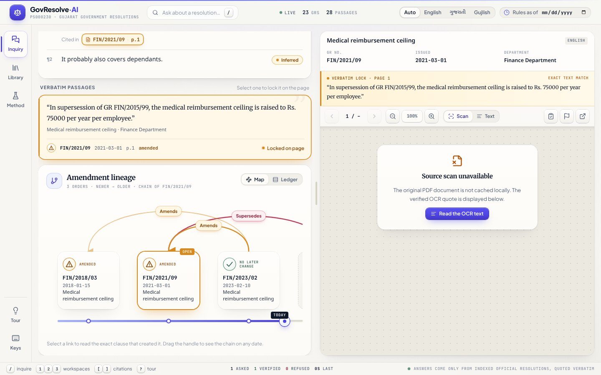
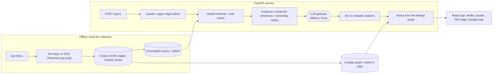

# GovResolve-AI

**Find the right Government Resolution, see the exact words and page, and know whether a later order has changed it.**

A bilingual (Gujarati and English) question-answering system for Government Resolutions (GRs), circulars and notifications. It answers
only from retrieved official documents, quotes them verbatim with page and date, traces amendments and replacements, and says
"insufficient evidence" instead of guessing. Built for problem statement **PS000230** of the Seva First Innovation Challenge.

[](https://github.com/Vivek-Maheshwari-07/GovResolve-AI/actions/workflows/ci.yml)
[](LICENSE)
[](requirements.txt)
[](docs/LLM_PROVIDERS.md)



## Contents

- [Why it exists](#why-it-exists) · [Features](#features) · [Screenshots](#screenshots) · [How it works](#how-it-works)
- [Quick start](#quick-start) · [Choosing a language model: Ollama or Groq](#choosing-a-language-model-ollama-or-groq) · [Docker](#docker)
- [Using your own collection](#using-your-own-collection) · [Configuration](#configuration) · [API](#api)
- [Project layout](#project-layout) · [Development](#development) · [Results](#results) · [Known limitations](#known-limitations)
- [Documentation](#documentation) · [Contributing](#contributing) · [License](#license)

## Why it exists

Government rules are amended and replaced quietly. A 2018 order can be superseded in 2021 while the old copy stays in the file, and a
keyword search finds both. An officer who acts on the outdated one risks a penalty overturned at a tribunal, an audit para, or a
citizen turned away at the counter. GovResolve-AI makes the lineage of a rule visible next to every answer.

## Features

- **Gujarati, English and mixed questions.** Gujlish (Gujarati in Latin letters) is normalised with an administrative glossary; non-English
  questions are also rendered in English so they can reach English resolutions.
- **Scanned and digital documents.** Text layers are read directly; scanned or badly encoded Gujarati pages are OCR'd with Tesseract
  (`guj+eng`), keeping whichever reading scores better.
- **Grounded answers.** Hybrid retrieval (BM25 and bge-m3 vectors, rank-fused) feeds numbered sentences to the model. The model returns
  sentence IDs; the application copies the quotes, so a quote can never be reworded.
- **Verifiable evidence.** Every citation carries the GR number, issue date, page and the box of its paragraph. The original PDF opens
  on that page with the paragraph highlighted.
- **Amendment lineage.** Explicit phrases ("in supersession of", "further to amend", and their Gujarati forms) create links from the
  newer order to the older one. Statuses and a visual timeline show what changed and when, and a Rule Time Machine shows the chain on any date.
- **Established versus inferred.** Each statement is labelled, and a Trust Shield summarises the quotes, sources and lineage checks behind an answer.
- **Refuses rather than guesses.** Out-of-scope, too-vague or unsupported questions get a coded refusal (`NO_DOCUMENT`, `TOO_VAGUE`, `OUT_OF_SCOPE`,
  `BROKEN_CHAIN`, ...). The system never calls a rule "active": finding no later order does not prove a rule is in force.
- **Ollama or Groq.** Run the model locally with Ollama (offline, private) or use Groq's hosted API (fast); each is the other's fallback.
  With no model at all it still returns one verbatim passage with a warning. See [docs/LLM_PROVIDERS.md](docs/LLM_PROVIDERS.md).

## Screenshots

| Answer with verdict seal and Trust Shield | Amendment lineage with time scrubber |
|---|---|
|  |  |

*Screenshots use the synthetic demo documents bundled in `data/fixtures`.*

## How it works



Every answer carries one of these statuses, derived only from explicit references in the documents:

| Status | Meaning |
|---|---|
| Found + No later change | No amending or replacing order was found in the indexed collection. Not proof the rule is in force. |
| Found + Amended | A later order amends a cited document; the lineage shows which and quotes the sentence. |
| Found + Superseded | A later order replaces or cancels a cited document; the successor is shown. |
| Insufficient evidence | The documents cannot establish an answer; a reason code explains why. |

A fifth status, Conflict, is designed in the UI but not emitted by the backend yet. A full description (high-level and low-level design,
models, evaluation) is in [docs/GovResolve-AI_HLD_LLD.pdf](docs/GovResolve-AI_HLD_LLD.pdf).

## Quick start

**Requirements:** Python 3.10+, Node.js 18+ (20 recommended) to build the web app, and either [Ollama](https://ollama.com) or a Groq key for
answers. Tesseract is only needed to build a corpus from PDFs.

```bash
git clone https://github.com/Vivek-Maheshwari-07/GovResolve-AI.git
cd GovResolve-AI
python -m venv .venv && source .venv/bin/activate     # Windows: .venv\Scripts\activate
make install                                           # or: pip install -r requirements.txt && cd frontend && npm ci
make ui                                                # builds the web app once
cp .env.example .env
```

**1. Try the demo.** No model and no data needed; it runs on 23 synthetic documents and returns the best matching passages.

```bash
make demo        # http://localhost:8000  (API docs at /docs)
```

**2. Connect a language model** (next section), then check it:

```bash
make llm-check
```

**3. Ask real questions.** Full answers need a corpus and a search index, which are not in this repository
([Using your own collection](#using-your-own-collection)). With both in place, `make run` starts the whole system.

## Choosing a language model: Ollama or Groq

The model chooses which evidence sentences answer the question and phrases a short answer; it never writes the quotes. Set
`LLM_PROVIDER` in `.env`. The chosen provider is tried first and the other is the fallback.

| | Ollama (local) | Groq (hosted) |
|---|---|---|
| Documents leave your machine | No | The question and retrieved passages are sent |
| Key | None | `GROQ_API_KEY` |
| Speed (reported) | 35 to 80 s per answer on a laptop CPU | about 10 s |
| Default model | `qwen3.5:4b` | `openai/gpt-oss-120b` |

**Ollama**

```bash
ollama pull qwen3.5:4b        # answers
ollama pull bge-m3            # search embeddings
```
```ini
LLM_PROVIDER=ollama
OLLAMA_HOST=http://localhost:11434
OLLAMA_MODEL=qwen3.5:4b
EMBEDDING_MODEL=ollama:bge-m3
```

**Groq**

```ini
LLM_PROVIDER=groq
GROQ_API_KEY=gsk_...          # from https://console.groq.com/keys, never commit it
GROQ_MODEL=openai/gpt-oss-120b
```

Use both by naming one as `LLM_PROVIDER` and configuring the other; rate limits (HTTP 429) are retried automatically honouring `Retry-After`
before the fallback is used. Embeddings for the search index always come from Ollama (`bge-m3`) unless `EMBEDDING_MODEL` says otherwise.
Full guide, all settings and troubleshooting: **[docs/LLM_PROVIDERS.md](docs/LLM_PROVIDERS.md)**.

## Docker

```bash
cp .env.example .env          # set GOV_ADMIN_TOKEN (required) and GROQ_API_KEY, or use the Ollama profile
docker compose up -d          # API + web app on http://localhost:8000

# local models instead of Groq
docker compose --profile ollama up -d
docker compose --profile init run --rm ollama-pull
```

The container listens on all interfaces, so Compose refuses to start without `GOV_ADMIN_TOKEN`. Put your corpus and index under `./data`
(mounted into the container). The Dockerfile is built and validated in CI.

## Using your own collection

The 366-resolution collection used in evaluation is built from public PDFs and is not stored in git. To use your own:

1. Convert PDFs to corpus records (text layer or OCR) with `backend/scripts/build_corpus.py` (needs Tesseract with `eng` and `guj` data; copies are in `data/tessdata`).
2. Build the search index (slow with a CPU embedder: about 1.4 chunks per second for bge-m3; re-runs only add new or changed chunks):
   ```bash
   make index CORPUS=data/corpus_v2
   ```
3. Point the app at them and start it:
   ```ini
   GOV_ENGINE=squad2
   GOV_CORPUS_DIR=./data/corpus_v2
   GOV_PDF_EXTRA_DIRS=/path/to/the/pdfs      # so the page viewer can open the originals
   ```
   ```bash
   make run
   ```

Details of each step, the record format and the evaluation tools are in [backend/README.md](backend/README.md).

## Configuration

Everything is configured through environment variables (or `.env`). The most important:

| Variable | Default | Meaning |
|---|---|---|
| `LLM_PROVIDER` | `ollama` | `ollama`, `groq`, `openai`, `gemini` or `auto` (first choice; the others are fallbacks) |
| `OLLAMA_HOST`, `OLLAMA_MODEL` | `http://localhost:11434`, `qwen3.5:4b` | Local model |
| `GROQ_API_KEY`, `GROQ_MODEL` | unset, `openai/gpt-oss-120b` | Hosted model |
| `EMBEDDING_MODEL` | `ollama:bge-m3` | Embedder for the vector index (rebuild the index when it changes) |
| `GOV_ENGINE` | `retrieval` (`squad2` in `.env.example`) | `squad2` = full RAG pipeline; `retrieval` = passages only |
| `GOV_ADMIN_TOKEN` | empty | Protects `/admin/*` and writes to `/documents`. **Set it before exposing the server.** |
| `GOV_QUERY_RATE_PER_MIN` | `120` | Questions per client address per minute |
| `ANSWER_CHECK` | `off` | Optional second model call: `warn` or `refuse` when the cited sentences do not answer the question |

All settings, with comments, are in [`.env.example`](.env.example).

## API

The service listens on port 8000; interactive docs are at `/docs`. The contract shared with the web app is in
[backend/API_CONTRACT.md](backend/API_CONTRACT.md) and its fields are frozen.

| Endpoint | Purpose |
|---|---|
| `POST /query` | Ask a question; returns the verdict, answer, citations with lineage, warnings and labelled statements |
| `GET /lineage/{doc_id}` | The whole amendment chain of a document, in timeline order |
| `GET /documents`, `GET /documents/{id}` | Metadata (department, subject, GR number, date) and lineage status |
| `GET /grs`, `GET /grs/{id}/pdf`, `GET /grs/{id}/pages/{n}` | Library list, original PDF, OCR text of a page |
| `POST /documents` | Add a document to the lineage graph (admin token when set) |
| `GET /health` | Counts and engine status |

```bash
curl -s localhost:8000/query -H 'Content-Type: application/json' \
     -d '{"question": "By how much was the upper age limit relaxed in 2022?"}'
```

## Project layout

```text
backend/
  app/            FastAPI service, lineage graph (app/graph.py) and clause-level lineage engine (app/lineage/)
  rag/            Retrieval and answer pipeline; llm_gateway.py and providers/ (Ollama, Groq, OpenAI-compatible, Gemini)
  ingestion/      PDF to corpus records: text layer, OCR, metadata, chunking
  scripts/        Corpus and index builders, evaluation tools, llm_smoke (provider check)
  tests/          pytest suite (439 tests)
frontend/         React app: landing page, guided tour, Ask / Library / Method workspaces
data/             Demo fixtures, Tesseract language data (corpus and index are generated, not in git)
eval/             Gold questions, gold lineage pairs, scorecards
docs/             Documentation and design PDF
```

## Development

```bash
make install-dev   # test and lint dependencies
make test          # backend (pytest) and frontend tests
make lint          # ruff, pyflakes rules
make help          # every shortcut
```

CI runs lint, the backend tests on Python 3.11 and 3.12, the frontend tests and build, and a Docker build on every push and pull
request ([.github/workflows/ci.yml](.github/workflows/ci.yml)). Provider code is tested against a local fake of Ollama and Groq, so the
tests need no network and no key.

## Results

Measured by the team on its own question sets, with a local `qwen3.5:4b` model ([eval/SCORECARD_SUMMARY.md](eval/SCORECARD_SUMMARY.md)):

| Metric | Dev set (50 questions) | Held-out (16 questions) |
|---|---|---|
| Quote found verbatim on its page | 100% | 100% |
| Unanswerable questions refused with the right reason | 15 of 15 | 5 of 5 |
| Correct document first / in first three | 82.9% / 94.3% | 72.7% / 72.7% |
| Answerable questions answered correctly | 24 of 35 (69%) | 6 of 11 (55%) |
| Amendment pairs (71 gold pairs) | precision 0.972, recall 0.972 | same graph |

Read these as indicative: the dev set was used to tune the code, the held-out set is small, and the questions and lineage pairs were
drafted by the team and are **not yet validated by officers**.

## Known limitations

- The lineage engine does not understand negation or proposals: a sentence like "does not supersede GR X" can create a supersede link.
- The admin token is off by default; anyone who can reach an unprotected server can add documents that change statuses.
- Gujarati amendment phrases are partly unconfirmed on real documents, and the gold lineage pairs are English only.
- With a local model on a CPU an answer takes 35 to 80 s; use Groq or a GPU for interactive use.
- The corpus, search index and original PDFs are not in the repository.

The full list of findings, with evidence and fixes, is in [docs/GovResolve-AI_HLD_LLD.pdf](docs/GovResolve-AI_HLD_LLD.pdf) (section 5).

## Documentation

| Document | What it covers |
|---|---|
| [docs/LLM_PROVIDERS.md](docs/LLM_PROVIDERS.md) | Ollama and Groq setup, fallback, settings, troubleshooting, adding a provider |
| [docs/GovResolve-AI_HLD_LLD.pdf](docs/GovResolve-AI_HLD_LLD.pdf) | High-level and low-level design, model inventory, evaluation, roadmap |
| [docs/REQUIREMENTS_TRACEABILITY.md](docs/REQUIREMENTS_TRACEABILITY.md) | Every requirement of PS000230 mapped to its evidence |
| [backend/README.md](backend/README.md) | Backend run guide and corpus tools |
| [backend/API_CONTRACT.md](backend/API_CONTRACT.md) | The frozen API contract |
| [CHANGELOG.md](CHANGELOG.md) | What changed |

## Contributing

Issues and pull requests are welcome; please read [CONTRIBUTING.md](CONTRIBUTING.md) first. It lists the hard rules that tests enforce
(edge direction, explicit references only, no "active" status, verbatim quotes, frozen API fields). Report security problems privately,
see [SECURITY.md](SECURITY.md).

## License

[MIT](LICENSE). The documents in `data/fixtures` are synthetic. Answers are retrieved information, not legal advice; verify against the
original resolution before acting.
