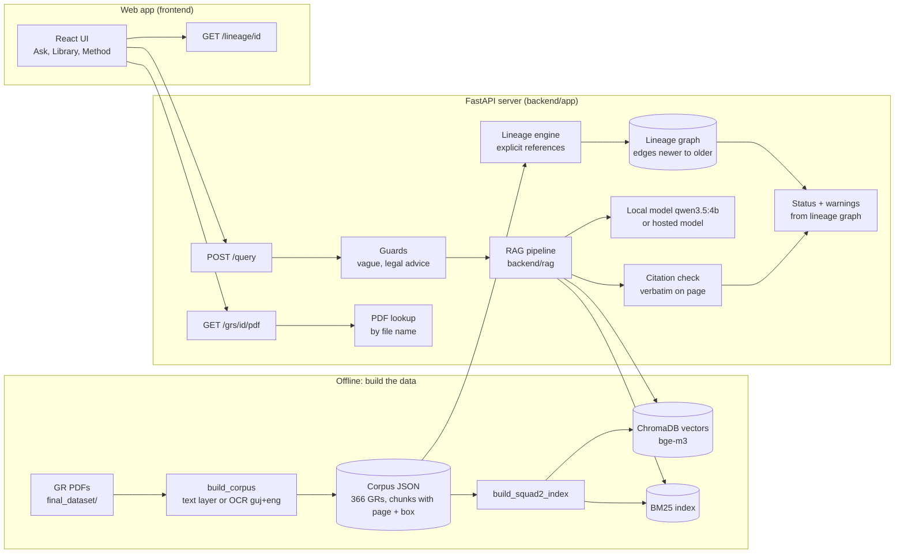
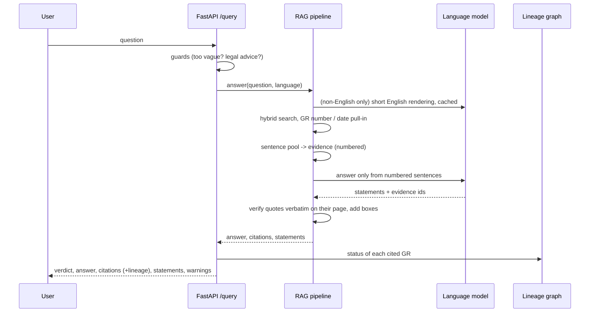

# GovResolve-AI: Project Documentation

**Problem statement PS000230, Seva First Innovation Challenge: _Find the Right Government Resolution_**
A Gujarati–English assistant that finds the right Government Resolution (GR), answers in everyday language, proves every claim with the page and the exact passage,
and tells you whether a later order has amended or replaced it.

Version: code freeze build, November 2026 · Repository: `Vivek-Maheshwari-07/GovResolve-AI` (branch `main`)

---

## Contents
1. [The problem](#1-the-problem)
2. [What GovResolve-AI does](#2-what-govresolve-ai-does)
3. [A tour of the app](#3-a-tour-of-the-app)
4. [Architecture](#4-architecture)
5. [Data: the GR collection](#5-data-the-gr-collection)
6. [How an answer is made](#6-how-an-answer-is-made)
7. [Amendment lineage](#7-amendment-lineage)
8. [The API](#8-the-api)
9. [The web app](#9-the-web-app)
10. [Security and privacy](#10-security-and-privacy)
11. [Setup and running](#11-setup-and-running)
12. [Configuration](#12-configuration)
13. [Testing and evaluation](#13-testing-and-evaluation)
14. [Results](#14-results)
15. [Known limits](#15-known-limits)
16. [Repository map](#16-repository-map)
17. [Future work](#17-future-work)
18. [Glossary](#18-glossary)

---

## 1. The problem

Gujarat's departments publish Government Resolutions, circulars and notifications continuously, in Gujarati and English, many as scanned PDFs.
An officer who needs a rule faces three questions:

1. **Which document says it?** Search is slow, and keyword search fails across languages and OCR noise.
2. **What exactly does it say, and where?** A summary is not enough for an office file or a tribunal: the page and the exact wording are needed.
3. **Is it still the one to follow?** A later order may have amended, replaced or cancelled it. Acting on an outdated order is a real administrative risk.

The challenge asks for an assistant that answers questions in everyday language from retrieved official documents, shows the supporting document, passage,
page number and date, identifies explicit amendments, replacements and superseded orders, separates established facts from assumptions, and clearly says when the
documents cannot establish an answer or its current applicability.

**Users:** government officers, establishment branches, and citizens.

---

## 2. What GovResolve-AI does

| Requirement in the problem statement | How GovResolve-AI meets it |
|---|---|
| Search scanned and digital documents | Digital text layers are read directly; scanned and badly encoded Gujarati PDFs are OCR'd with Tesseract (`guj+eng`). 366 GRs, 7,501 passages. |
| Gujarati, English and mixed questions | Language is detected; Gujarati and Gujlish (Gujarati in Latin letters) questions also get a short English rendering so they can reach English GRs. |
| Extract department, subject, GR number, issue date | Taken from the portal listing and the document text, stored per GR, shown in the evidence panel and the Library. |
| Answers grounded in retrieved documents | Hybrid retrieval (BM25 + multilingual vectors), sentence-level evidence, a model that may only use the numbered evidence sentences. |
| Show the document, exact passage and page | Every citation carries the GR, page, verbatim quote and the box of the paragraph on the page; the original PDF opens with that paragraph highlighted. |
| Identify explicit amendments, replacements, superseded orders | A rule-based lineage engine reads explicit references ("further to amend ...", "in supersession of ...") and builds a graph; every answer shows the status of the documents it cites. |
| Distinguish facts from assumptions | Each statement is labelled `established` (stated in a cited passage) or `inferred`. |
| Say when documents are insufficient | The system refuses with a reason code (`NO_DOCUMENT`, `TOO_VAGUE`, `OUT_OF_SCOPE`, `BROKEN_CHAIN`, ...). It never says a rule is "active". |

**Principles the code keeps (hard rules)**
- Lineage edges point **newer → older** (the acting order to the order it acts on).
- **Only explicit references** create edges. No guessing from topic similarity.
- **No "active" status anywhere.** Finding no later order in the collection does not prove a rule is in force; the status is `no_later_amendment_found`.
- **Quotes are verbatim**, checked against the page text before they are shown.
- The public API fields are frozen: nothing renamed or removed.

---

## 3. A tour of the app

Start it with `python run.py` and open http://localhost:8000. A five-step guided tour runs on the first visit (press `?` to replay it).

**Header.** Brand and a live "Truth Layer" indicator; the number of GRs indexed; session counters (questions, verified answers, refusals, last answer time);
a language switch (Auto, English, ગુજરાતી, Gujlish); and the **Rule Time Machine** date ("Rules as of ...").

**Left rail: three workspaces.**

1. **Ask**
   - A landing view explains the product, with feature cards, colour-coded real sample questions (English, amended rule, ગુજરાતી, Gujlish, not in the corpus) and a legend of the statuses.
   - While an answer is prepared, a four-stage progress view runs (normalise query, search index, trace lineage, verify quotes).
   - An answer shows: a **status banner** (No later change / Amended / Superseded / Insufficient evidence, with the reason code for refusals), the **answer**, the **statements** with their labels and citation chips,
     the **verbatim quotes**, and the **amendment lineage** of the first cited document as a timeline (or grid). Clicking a document in the lineage opens it.
   - The **evidence panel** on the right shows the GR's number, date, department and language, the cited passage, and the PDF page scrolled to the citation with the paragraph highlighted.
     Tools: page and zoom, raw OCR text of the page (matching paragraph highlighted), copy a court-ready citation, copy a wrong-citation report, open the PDF.
2. **Library**: all GRs, newest first. Search by GR number, subject or date; filter by language and by status (with counts). Opening a GR shows its PDF and its lineage.
3. **Method**: the five pipeline steps, the measured results with their caveats, the rules the system never breaks, and live collection counts.

**Rule Time Machine.** Pick a date: documents issued after it are dimmed as "not yet issued", and a document counts as amended or superseded only if the acting order existed by then.

**Keyboard.** `/` ask · `1 2 3` workspaces · `[ ]` previous / next citation · `?` tour · `Esc` close.

---

## 4. Architecture



**Main parts**

| Part | Where | What it does |
|---|---|---|
| Corpus builder | `backend/scripts/build_corpus.py` | Turns PDFs into one JSON record per GR: metadata and text chunks with page numbers and boxes. Decides between text layer and OCR. |
| Search index | `backend/scripts/build_squad2_index.py`, `backend/rag/search_engine.py` | ChromaDB vectors (bge-m3 via Ollama) and a BM25 keyword index over the same chunks. |
| Answer pipeline | `backend/rag/` | Query preparation, retrieval, evidence building, prompting, parsing, citation verification. |
| Bridge | `backend/app/squad2_bridge.py`, `squad2_runtime.py` | Runs the pipeline inside the API and supplies our lineage to it. |
| Lineage engine | `backend/app/lineage/` | Finds explicit references, resolves them to GRs, builds the graph and statuses. |
| Contract graph | `backend/app/graph.py`, `detector.py` | The document-level graph behind `/documents`, `/lineage` and `/query` statuses. |
| API | `backend/app/main.py`, `routers/api.py` | Contract endpoints, library and PDF routes, hardening. |
| Web app | `frontend/` | React + Tailwind + Framer Motion, served by FastAPI from `frontend/dist`. |
| Launcher | `run.py`, `start.bat` | One command: finds data, builds the UI once, starts the server. |

---

## 5. Data: the GR collection

**Sources.** `final_dataset/` holds the curated PDFs (on disk only, not in git) and the manifests from the GAD portal and related departments, in tiers (`01_core_gad_searchable`,
`02_extension_panchayat_amendments`, `03_scanned_ocr_sample_gad`, `04_friend_supplement`), with `manifest.csv`, `rule_families.csv`, `chains_candidates.csv`
and per-file source URLs. The rule-family records (amendment chains) were OCR'd separately.

**Corpus v2** (`corpus_v2`, 366 GRs, outside git):
- Each record: `gr_id`, `gr_number` (and a normalised form), `department`, `issue_date`, `subject`, `language`, `source_pdf`, `page_count`, and `chunks`
  (`chunk_id`, `page`, `text`, `bbox` in PDF points, `section`, `clause_label`).
- **Text or OCR.** Many Gujarati PDFs embed fonts that map Gujarati to Latin gibberish. `build_corpus` detects garbled text (Latin words that are not English),
  OCRs with `guj+eng` and keeps the better text; language is taken from the script. Garbled documents went from 66 to 0; OCR text is used for 137 documents.
- **Metadata** comes from the portal listing where available (issue date, GR number, subject), else from the text.
- **Index:** 7,501 chunks in ChromaDB plus BM25. Rebuilding embeds only new or changed chunks.

**Not in git** (must exist on the machine): the corpus JSON, the search index (`data/index/chroma`), `.env`, the translation cache
(`data/index/translations.json`), and the PDFs (`final_dataset/`, `D:/test/dataset_organized`). `backend/README.md` explains how to rebuild them.

**Synthetic fixtures** (`data/fixtures/`, 23 small records) are used by the tests and when no real corpus is present. They include a superseded order,
which the real corpus does not have.

---

## 6. How an answer is made

`POST /query` with a question (and optionally its language). The default engine for the real corpus is the RAG pipeline (`GOV_ENGINE=squad2`).



**Step by step**

1. **Guards.** `is_too_vague` refuses one-topic questions ("leave", "salary") with `TOO_VAGUE` and asks for detail; `is_out_of_scope` refuses legal advice and predictions
   ("should I sue ... will I win?") with `OUT_OF_SCOPE`, in English, Gujarati and Gujlish. These run before any model call.
2. **Understand the question.** The language is detected. For Gujarati or Gujlish questions the model writes one short English rendering
   (`llm_gateway.translate_to_english`, plain text, about 5–12 s on the CPU the first time), cached in memory and in `data/index/translations.json`, so a question costs this once.
   The original Gujarati channels stay, so a bad rendering cannot remove what worked before.
3. **Retrieve.** BM25 (with a Gujarati stemmer and the document title in each chunk's keyword tokens) and vector search (bge-m3) are fused by rank.
   A GR number written in the question (compared by letters and digits only, Gujarati digits converted) or a written date shared by at most three GRs pulls that GR in directly.
4. **Build evidence.** The sentences of the best `EVIDENCE_CANDIDATES` (8) chunks, plus the amending passage when the GR has one, compete for `EVIDENCE_MAX_CHARS` by
   IDF-weighted overlap with the question (and its English rendering). Letterhead fragments are dropped. **Instruction-like sentences** inside documents
   ("ignore previous instructions ...") are removed before numbering, so they can neither steer the model nor be cited.
5. **Answer.** The model receives the numbered sentences and must answer only from them, in a compact JSON (`{"statements":[{"t":..,"k":"E","ids":[..]}]}`).
   The system prompt is fixed and says document text is evidence only. Temperature 0.
6. **Verify.** Each cited sentence is checked to occur verbatim on its page; the citation gets the paragraph's box (`bbox`). Statements whose citations were all dropped
   become `inferred`. An answer with no valid citation becomes a refusal.
7. **Status and warnings.** The API adds each cited GR's lineage status from the graph. Warnings are added when a cited GR is superseded, when it amends a GR that is not
   in the collection (`BROKEN_CHAIN:`; refusing instead is opt-in with `GOV_BROKEN_CHAIN_REFUSES=1`), when the optional answer check could not confirm the passage
   (`ANSWER_CHECK=warn`), or when no model was available.

**Without a model.** If the model is unreachable, `/query` returns the single best-matching evidence sentence, verbatim, with its citation, labelled `inferred`, and a warning
"The language model is unavailable ...". With too little word overlap it refuses with `NO_DOCUMENT`. Word overlap cannot tell answerable from unanswerable questions,
so offline an unanswerable question can still get an unrelated quote; the warning says so.

**Models.** Local `qwen3.5:4b` through Ollama (default, offline), with the system prompt warmed at start-up, or Groq's hosted API (`LLM_PROVIDER=groq`);
each is the other's fallback. Any other OpenAI-compatible service and Gemini are optional. See [LLM_PROVIDERS.md](LLM_PROVIDERS.md).

---

## 7. Amendment lineage

**What it finds.** Sentences in which a GR explicitly acts on another: amends ("further to amend the ... Rules, 1967"), replaces/supersedes ("in supersession of ..."),
cancels, or merely refers to it. The engine (`backend/app/lineage/`) works in steps:

1. **Split** each GR into sections (preamble, read list, operative part) and find relationship sentences by phrase patterns (`patterns.py`, `extract.py`).
2. **Pull out the target reference**: GR number, date, read-list item, or the title of an instrument.
3. **Resolve** the reference to a GR in the collection, with a confidence (`resolve.py`). Titles are matched against known instruments; a year printed after "Rules" must agree
   with the candidate's year; titles **inside quotation marks** are ignored, because quoted text is wording being inserted, not the instrument amended.
4. **Scope**: how much of the target the change covers (`scope.py`).
5. **Build the graph** with edges **newer → older**, and derive each GR's status (`graph.py`, `status.py`).

A model-based classifier for sentences that point at a GR but match no phrase exists in the code (`llm_fallback.py`) but is **not enabled**: every edge in the running system comes from rules.

**Statuses.** `superseded` (a later order replaces or cancels it), `amended` (a later order amends it), `no_later_amendment_found`, `unknown`.
Edges and nodes for GRs referenced but not in the collection appear as external stubs (`ext:...`, "not in the collection").

**Measured quality.** Against 71 verified amendment pairs (English rule families): precision 0.972, recall 0.972 (69 of 71 found). Two of the "false positives"
are real amendments missing from the portal's own list, so precision is understated.

**Rule Time Machine** (in the web app, `frontend/src/lib/lineage.js`): computes the statuses as of a chosen date from the same edges, counting an acting order only if it was issued by then.

**Known gap.** Gujarati lineage barely works: in 134 Gujarati documents the read list is not parsed (one long OCR paragraph), the guessed Gujarati phrases do not match
real wording, and most cited GRs are not in the collection. The diagnosis and a fix list are in `backend/notes/part2_answers.md` (section 2.3).

---

## 8. The API

Base URL `http://localhost:8000`; interactive docs at `/docs`. JSON, UTF-8, pages 1-based, dates ISO. The full contract is in `backend/API_CONTRACT.md`.

**Contract endpoints (frozen fields)**

| Method | Path | Purpose |
|---|---|---|
| POST | `/query` | Ask a question. Returns `verdict` (`answered` / `insufficient_evidence`), `answer`, `citations[]` (`doc_id`, `page`, `quote`, `issue_date`, `bbox`, `lineage`), `statements[]` (`text`, `label`, `citations`), `warnings[]`, `reason`, `reason_code`, `language`. |
| POST | `/documents` | Ingest one document (text per page); its references are linked. |
| GET | `/documents`, `/documents/{doc_id}` | Metadata; detail includes the lineage status. |
| GET | `/lineage/{doc_id}` | The whole chain: `nodes`, `edges` (with evidence quote and page), `timeline` (left-to-right order). |
| GET | `/lineage/{doc_id}/status` | One document's status, summary, acting orders, latest documents, notes. |
| GET | `/edges` | Every edge (debugging). |

**Library, PDF and other endpoints**

| Method | Path | Purpose |
|---|---|---|
| GET | `/health` | Counts: GRs, chunks, edges, broken links, vectors. |
| GET | `/grs`, `/grs/{gr_id}` | GR list (filters: department, year, status, q) and one record. |
| GET | `/grs/{gr_id}/pdf` | The original PDF, found by file name under `data/raw`, `final_dataset/` and `GOV_PDF_EXTRA_DIRS` (recursively). |
| GET | `/grs/{gr_id}/pages/{n}` | The text blocks of a page. |
| GET | `/grs/{gr_id}/lineage`, `/clauses/{chunk_id}/status`, `/lineage/as-of`, `/lineage/broken` | Clause-level lineage tools. |
| POST | `/ask`, `/feedback`; GET `/logs` | Older question endpoint with a query log and feedback. |
| POST | `/admin/rebuild`; GET/POST `/admin/edges/overrides` | Rebuild the data; manual edge corrections. Protected by `GOV_ADMIN_TOKEN` when set. |

**Reason codes:** `NO_DOCUMENT`, `TOO_VAGUE`, `MISSING_FACTS`, `BROKEN_CHAIN`, `POOR_SCAN`, `OUT_OF_SCOPE`.

---

## 9. The web app

**Stack.** React 18, Vite, Tailwind CSS, Framer Motion, Lucide icons, PDF.js. Fonts (Plus Jakarta Sans, Noto Sans Gujarati, Merriweather, JetBrains Mono) and the PDF.js
worker are bundled, so the app works offline. FastAPI serves the built app from `frontend/dist`; `npm run dev` proxies the API for development.

**Design.** A low-glare light theme ("Warm Alabaster & Legal Ink"): warm paper canvas, ivory cards, deep slate text, no pure white page and no pure black text.
Each idea has one colour used the same way everywhere: indigo = search, teal = bilingual, amber = evidence and citations, violet = lineage, rose = refusals;
emerald / amber / rose pastel pills for the status of an answer. Verbatim quotes use a serif face with roomy line height; GR numbers and dates use a monospace face.

**Code map** (`frontend/src/`)

| File | Role |
|---|---|
| `api.js` | The only place that talks to the backend. Turns contract responses into the shapes the components use; maps statuses (never "active"). |
| `lib/status.js` | The status taxonomy, reason-code names and colour tones. |
| `lib/lineage.js` | Rule Time Machine, court-ready citation text, wrong-citation report text. |
| `lib/samples.js` | The sample questions and their colours. |
| `App.jsx` | Workspaces, state, keyboard shortcuts, session counters, tour. |
| `components/TopBar`, `Rail`, `Tour` | Header, workspace rail (bottom tabs on phones), spotlight tour. |
| `components/QueryDock`, `Hero`, `PipelineLoader` | Question box (with Gujarati keyboard), landing view, progress view. |
| `components/StatusBanner`, `AnswerCard`, `LineageGraph` | The answer: status, statements, citation chips, quotes, lineage timeline. |
| `components/PdfInspector` | Evidence panel: metadata, PDF page with the citation box, raw OCR text, tools. |
| `components/Library`, `Method` | Library and Method workspaces. |

**Accessibility.** Buttons have labels, the status banner and warnings use `role="status"` / `role="alert"`, keyboard shortcuts cover the main actions,
motion is reduced when the system asks for it.

---

## 10. Security and privacy

- **Local by default.** `run.py` listens on 127.0.0.1 only; `--host 0.0.0.0` shares it on a network.
- **Admin token.** When `GOV_ADMIN_TOKEN` is set, `/admin/*` and writes to `/documents` need the header `X-Admin-Token` (constant-time comparison).
- **Rate limit.** Questions (`/query`, `/ask`) per client address per minute: `GOV_QUERY_RATE_PER_MIN` (default 120, 0 = off).
- **Input limits.** A question is at most 2,000 characters.
- **CORS.** Limited to localhost origins by default (`GOV_CORS_ORIGINS` to change).
- **Headers.** `X-Content-Type-Options: nosniff`, `X-Frame-Options: SAMEORIGIN`, `Referrer-Policy: no-referrer`.
- **PDF route.** The file name comes from our own corpus record and is reduced to its last part, so a request can never choose a path.
- **Prompt injection.** Instruction-like sentences inside documents are dropped before they reach the model (7 attack strings caught; 0 of 21,719 real sentences flagged).
- **Keys.** API keys live only in `.env` (git-ignored). With a hosted model, questions and GR text are sent to that provider; the GRs are public, but check the challenge rules.

---

## 11. Setup and running

**Prerequisites:** Python 3.10+, Node.js 18+ (to build the UI once), Git, [Ollama](https://ollama.com) with `qwen3.5:4b` and `bge-m3`, and the corpus and index (see below).

```bash
git clone https://github.com/Vivek-Maheshwari-07/GovResolve-AI.git
cd GovResolve-AI
python -m venv .venv
.venv\Scripts\python -m pip install -r requirements.txt -r backend/requirements.txt
copy .env.example .env
ollama pull qwen3.5:4b
ollama pull bge-m3
python run.py              # or double-click start.bat; opens http://localhost:8000
```

`run.py` looks for the corpus (`GOV_CORPUS_DIR`, `data/corpus_v2`, or `D:/test/corpus_v2`) and the index (`data/index/chroma`). With both it answers through the
RAG pipeline; otherwise it starts on the synthetic fixtures and says so. It adds known PDF folders to the PDF search, builds the UI the first time, and starts the server.
The first answer takes longer while the model loads; after that about 40–70 s per answer on a laptop CPU.

**Rebuild the data** (from `backend/`; slow because of OCR):
```bash
python -m scripts.build_corpus --manifest ../final_dataset/manifest.csv --root ../final_dataset \
    --sources ../final_dataset/SOURCES_full_per_file_urls.txt --families-json D:/test/gr_json_families --out D:/test/corpus_v2
python -m scripts.build_squad2_index --corpus D:/test/corpus_v2 --index ../data/index/chroma
```

**Use a hosted model:** in `.env` set `LLM_PROVIDER=groq` and `GROQ_API_KEY` (or `LLM_PROVIDER=openai` with `LLM_API_URL`, `LLM_API_KEY`, `LLM_API_MODEL`); check with `make llm-check` (prints OK/FAILED and seconds, never the key). Details: [LLM_PROVIDERS.md](LLM_PROVIDERS.md).

**Develop the UI:** `cd frontend && npm ci && npm run dev` (port 3000, proxies the API on 8000); `npm run build` for the served build; `npm test` for the logic tests.

---

## 12. Configuration

All in `.env` (template: `.env.example`) or the environment.

| Setting | Default | Meaning |
|---|---|---|
| `LLM_PROVIDER` | `ollama` | First choice: `ollama`, `groq`, `openai` (any OpenAI-compatible API), `gemini`, `auto`. The others are fallbacks. Legacy `local` and `api` still work. |
| `OLLAMA_HOST`, `OLLAMA_MODEL` | `http://localhost:11434`, `qwen3.5:4b` | Local model. Also `OLLAMA_REASONING=none`, `OLLAMA_TIMEOUT=180`, `OLLAMA_MAX_TOKENS=700`, `OLLAMA_KEEP_ALIVE=30m` (older `LOCAL_LLM_*` names work). |
| `GROQ_API_KEY`, `GROQ_MODEL` | empty, `openai/gpt-oss-120b` | Groq. Also `GROQ_TIMEOUT`, `GROQ_MAX_TOKENS`, `GROQ_MAX_RETRIES`, `GROQ_REASONING_EFFORT`. |
| `LLM_API_URL`, `LLM_API_KEY`, `LLM_API_MODEL`, `LLM_API_TIMEOUT` | empty, 60 | Any other OpenAI-compatible service. |
| `EMBEDDING_MODEL` | `ollama:bge-m3` | Embedder for the vector index. |
| `CHROMA_PERSIST_DIR` | `./data/index/chroma` | Search index location. |
| `TOP_K_RETRIEVE`, `TOP_K_RERANK` | 20, 3 | Passages retrieved / sent on. |
| `EVIDENCE_CANDIDATES`, `EVIDENCE_CHARS_PER_CHUNK`, `EVIDENCE_MAX_CHARS` | 8, 500, 1500 | Evidence budget. A fast hosted model can take 6000 / 1200 with `TOP_K_RERANK=5`. |
| `ANSWER_CHECK` | `off` | `warn` or `refuse`: a second model call checks the cited passage answers the question. |
| `TRANSLATION_CACHE` | `data/index/translations.json` | English renderings of non-English questions; empty turns the file off. |
| `EXTRACTIVE_MIN_COVERAGE` | 0.2 | Minimum overlap for the model-free fallback answer. |
| `GOV_ENGINE` | `retrieval` (`run.py` sets `squad2` with a real corpus) | Answer engine. |
| `GOV_CORPUS_DIR`, `GOV_PDF_DIR`, `GOV_PDF_EXTRA_DIRS` | fixtures, `data/raw`, none | Corpus and PDF folders. |
| `GOV_BROKEN_CHAIN_REFUSES` | off | Refuse (instead of warn) when an answer rests only on an amendment of a missing GR. |
| `GOV_ADMIN_TOKEN`, `GOV_QUERY_RATE_PER_MIN`, `GOV_CORS_ORIGINS` | off, 120, localhost | Security (section 10). |

---

## 13. Testing and evaluation

**Automated tests**
- Backend: `cd backend && python -m pytest -q` → **407 tests** (lineage engine, detector, graph, API contract, pipeline bridge, guards, injection guard,
  cross-lingual retrieval with a fake model, citation boxes, fallback answer, PDF lookup, security middleware, held-out set integrity). No model needed.
- Web app: `cd frontend && npm test` → **13 tests** (API adapter, status mapping that never shows "active", Rule Time Machine, citation text).

**Question sets** (`eval/`)
- **Development set** (`gold_questions.json`): 50 questions (35 answerable: 24 simple, 11 amended; 15 refusals: 10 unanswerable incl. legal-advice traps, 5 vague),
  in English, Gujarati and Gujlish. Each answerable one has gold documents, page and key points; the builder (`scripts/make_gold_questions.py`) fails unless every key point
  occurs on the cited page. Unanswerable ones are backed by a text search showing the topic is absent. The system was tuned on this set.
- **Held-out set** (`heldout_questions.json`): 16 questions (11 answerable, 5 refusals) on documents the development set never uses, written after the changes were frozen
  and scored once (`scripts/make_heldout_questions.py`).
- **Lineage gold** (`gold_lineage_verified.csv`): 72 portal pairs checked by reading the amending text; 71 confirmed, 1 rejected.
- All question sets were drafted from the document text by the team and are **not officer-validated** yet.

**Scorecard** (`scripts/scorecard.py`)
```bash
python -m scripts.scorecard --corpus D:/test/corpus_v2 --index ../data/index/chroma --mode retrieval          # about 1 minute, no model
python -m scripts.scorecard --corpus D:/test/corpus_v2 --index ../data/index/chroma --mode full --out ../eval/NEW.json   # about 40 minutes locally
python -m scripts.scorecard ... --gold ../eval/heldout_questions.json      # the held-out set
python -m scripts.scorecard ... --pause 25                                 # wait between questions (rate-limited hosted tiers)
```
It reports the five metrics of the problem statement: correct-document retrieval (first / first three), citation and page accuracy (and verbatim quotes),
answer correctness (key points), amendment-chain identification (pairs vs verified gold), and handling of unanswerable questions (refused, right reason code),
plus the share of answers whose key points were in the evidence, the lineage status shown, and latency.

---

## 14. Results

Local model `qwen3.5:4b` on a laptop CPU unless stated. Details and per-question files in `eval/` and `eval/SCORECARD_SUMMARY.md`.

| Metric | Development set | Held-out set |
|---|---|---|
| Right document first / in first three | 82.9% / 94.3% | 72.7% / 72.7% |
| Citation on the gold page | 83.0% | 71.4% |
| Quote verbatim on its page | **100%** | **100%** |
| Answerable questions answered correctly | 24 of 35 (69%) | 6 of 11 (55%) |
| Answerable questions wrongly refused | 4 of 35 | 2 of 11 |
| Refusals correct, right reason code | **15 of 15** | **5 of 5** |
| Amendment pairs vs verified gold | precision 0.972, recall 0.972 | (same graph) |
| Median / p95 seconds per answer | 45 / 66 | 48 / 76 |

**How the development numbers grew** (answered correctly, of 35): first full run 11 → evidence building 19 → cross-lingual retrieval 24.
Gujarati questions answered correctly went from 3 to 5 of 11, Gujlish from 4 to 7 of 9.

**Hosted model** (Groq `openai/gpt-oss-120b`, free tier): the one clean run (`ANSWER_CHECK=warn`) answered 26 of 35 correctly with 100% citations on the gold page and
about 10 s per answer. Runs with a bigger evidence budget reached 30–31 of 35 but were mixed with local fallbacks after rate-limit errors (8,000 tokens per minute),
so they are not counted. On the held-out set the hosted model was no better than the local one (about 6 of 11), and it was not deterministic.

**Reading the numbers honestly**
- The held-out numbers are the better guide for a new question: about 55–65% fully correct with the local model. 16 questions is a small sample.
- Quotes are never invented and refusals are reliable. The remaining errors are a wrong document or a wrong figure read from the right document, with a correct-looking quote,
  so the user should always read the cited passage (the app puts it on the page).

---

## 15. Known limits

- **Gujarati lineage barely works** (section 7). A Gujarati amendment is usually not flagged; e.g. the 13 May 2025 relaxation of the 9 May 2025 leave circular.
- **No superseded order in the real collection.** The `superseded` status is shown only on the synthetic fixtures.
- **Speed.** 40–70 s per answer on a CPU with the local model; the 10 s target needs a hosted model or a GPU.
- **Wrong-document answers** remain possible (e.g. naming other members of the same commission from sibling notices).
- **Offline fallback** can quote an unrelated passage for an unanswerable question (with a warning).
- **Citation boxes** mark the paragraph, not the exact line; scanned pages without a box show the quote only.
- **Not officer-validated:** the question sets and the lineage pairs still need sign-off by a resource person.
- **Not tested:** the Gujarati on-screen keyboard and the phone layout.

---

## 16. Repository map

```
GovResolve-AI/
├── run.py, start.bat              one-command launcher
├── README.md                      overview and quick start
├── AGENTS.md                      rules for AI coding tools working on the repo
├── .env.example                   all settings with comments (copy to .env)
├── requirements.txt               Python packages for the RAG pipeline
├── docs/                          problem statement (PS.txt, PS230.pdf), this document
├── final_dataset/                 manifests and source lists in git; the GR PDFs themselves stay on disk, outside git
├── data/fixtures/                 synthetic GRs for tests and the no-corpus mode
├── eval/                          question sets, lineage gold, scorecards, SCORECARD_SUMMARY.md
├── frontend/                      the web app (React + Vite + Tailwind)
│   └── src/  api.js, App.jsx, components/, lib/
└── backend/
    ├── app/                       FastAPI app: main.py, routers/, lineage/, schemas/, services/, security.py, pdf_lookup.py
    ├── rag/                       answer pipeline: search_engine.py, llm_gateway.py, Gujarati stemmer, Gujlish normaliser
    ├── scripts/                   build_corpus, build_squad2_index, scorecard, gold/held-out builders, llm_smoke, ...
    ├── tests/                     407 tests
    ├── notes/                     part1_ui.md, part2_answers.md: what was built, measured and why
    ├── API_CONTRACT.md, DEMO.md, IMPLEMENTATION_PLAN.md, README.md
    └── api/, ingestion/, lineage/ earlier pipeline modules (kept for reference)
```

---

## 17. Future work

1. **Gujarati lineage**: parse inline read lists, Gujarati pointer forms ("ક્રમાંક (૧) થી (૩)"), real phrases tied to a pointer in the same sentence; keep English pairs at P/R 0.97.
2. **Officer validation** of the question sets and the lineage pairs, then a larger held-out set.
3. **Speed**: a GPU or a paid hosted tier; then the bigger evidence budget, which looked better in the hosted runs.
4. **Wrong-document answers**: a stronger answer check, and preferring the GR named in the question.
5. **Exact-line highlights** instead of paragraph boxes.
6. **Feedback loop**: link the wrong-citation report to the query log (`/feedback`) once `/query` returns a query id.

---

## 18. Glossary

| Term | Meaning |
|---|---|
| GR | Government Resolution (ઠરાવ); also used here for circulars and notifications. |
| Gujlish | Gujarati written in Latin letters, often mixed with English ("navo tariff kya divas thi lagu thayo"). |
| Lineage | How GRs act on each other over time: amends, replaces, supersedes, cancels, refers to. |
| Edge | One explicit relationship, from the newer acting GR to the older GR it acts on, with the quote that says so. |
| No later change | Status when no later amending or replacing order was found in the collection. Not a claim that the rule is in force. |
| Established / Inferred | A statement stated in a cited passage / reasoned from the passages. |
| Reason code | Why the system refused (`NO_DOCUMENT`, `TOO_VAGUE`, `OUT_OF_SCOPE`, ...). |
| BM25 | A keyword-ranking method; combined with vector search for retrieval. |
| bbox | The box of the cited paragraph on its page, in PDF points from the top-left. |
| Held-out set | Questions never used while building the system, scored once to estimate real performance. |
